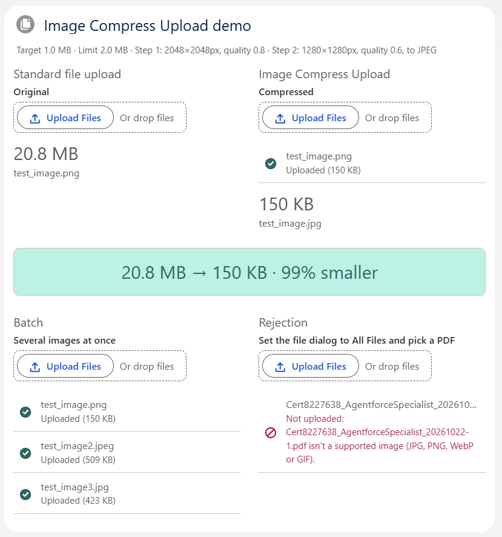

# lwc-image-compress-upload

An LWC that looks and behaves like `lightning-file-upload` but works with images only and **compresses each image in the browser before uploading it**. Compression uses the standard [`processImage`](https://developer.salesforce.com/docs/platform/lightning-component-reference/guide/lightning-media-utils.html) function from `lightning/mediaUtils`. Admins control it through Custom Metadata.

## Demo



`c-image-compress-upload-demo` puts the standard `lightning-file-upload` and Image Compress Upload side by side on a record page:

- **Same picture, both uploaders:** the banner shows both stored sizes and the saving. In the screenshot a 20.8 MB PNG is stored as a 150 KB JPEG, 99% smaller. Each side also shows the stored file's name.
- **Format conversion:** a PNG that a step converts to JPEG is stored as `.jpg` (`test_image.png` → `test_image.jpg`).
- **Batch:** several images at once, each with its own status (uploaded, or uploaded with a warning when still above the target).
- **Rejection:** a non-image is refused with a clear message. The file dialog hides non-images, so set it to All Files to pick a PDF.
- **Settings line:** the line under the title shows the active settings, so the numbers can be traced to the configuration.

To try it, add **Image Compress Upload Demo** to an Account page (or any record page) in App Builder.

## Installation

This repository contains only the source (`force-app`), not a full Salesforce DX project. To install it:

1. Copy `force-app` into a Salesforce DX project. To start a new one, run `sf project generate --name my-project`. Its default `.forceignore` already keeps the `__tests__` folders out of deploys.
2. Deploy and assign the permission set:

   ```sh
   sf project deploy start --source-dir force-app -o <org>
   sf org assign permset --name Image_Compress_Upload_User -o <org>
   ```

The demo component is optional. To leave it out, delete the three `lwc/imageCompressUploadDemo*` folders before deploying.

The **Image Compress Upload User** permission set grants access to the `ImageCompressUploadController` Apex class and read access to both Custom Metadata types. Assign it to everyone who uses the component.

## Using the component

In App Builder, add **Image Compress Upload** to a Record, App or Home page. In your own LWC:

```html
<c-image-compress-upload
  label="Site photos"
  record-id="{recordId}"
  multiple
  onuploadfinished="{handleUploadFinished}"
></c-image-compress-upload>
```

```js
handleUploadFinished(event) {
  // Same shape as lightning-file-upload; only the files that were stored.
  const { files } = event.detail; // [{ name, documentId }]
}
```

| Property    | Default                 | Notes                                                                                       |
| ----------- | ----------------------- | ------------------------------------------------------------------------------------------- |
| `label`     | "Upload Images"         | Text above the file selector.                                                               |
| `record-id` | the record on the page  | Files are shared with this record. Without it they stay private to the uploader.            |
| `multiple`  | `false`                 | Allow several files at once. They are processed and uploaded one after another.             |
| `disabled`  | `false`                 | The selector is also disabled while files are processing and when the settings can't load.  |
| `accept`    | `.jpg,.jpeg,.png,.webp` | Can only narrow the supported list `.jpg .jpeg .png .webp .gif`. GIFs lose their animation. |

## How it works

1. The user picks one or more images in `lightning-input type="file"`, which renders the same SLDS File Selector as the standard component.
2. A file outside the accepted types is rejected straight away. The dialog's type filter can be switched to All Files, so every file is checked again.
3. An image already at or under **Target Size** is uploaded as it is.
4. Otherwise the **Image Compression Steps** run in `Order`. Every step starts again from the original image, and the first result that fits under the target is used.
5. If no step fits, the smallest result is used:
   - at or under **Max Upload Size**: it's uploaded with a warning;
   - over it: it's rejected.
6. Each file is uploaded in its own Apex call as a `ContentVersion`. Apex checks the file type and size again, then inserts the file with the user's permissions (`USER_MODE`).
7. `uploadfinished` fires with `{ files: [{ name, documentId }] }`, the same shape as the standard component.

Each file's status (waiting, compressing, uploading, uploaded, warning, failed) is shown in the list under the selector.

## Configuration (Setup → Custom Metadata Types)

**Image Compression Settings**, record `Default`:

| Field                | Shipped value | Meaning                                                                                                                                                                      |
| -------------------- | ------------- | ---------------------------------------------------------------------------------------------------------------------------------------------------------------------------- |
| Target Size (KB)     | 1024          | Images above this size are compressed.                                                                                                                                       |
| Max Upload Size (KB) | 2048          | Hard limit for one upload through Apex. 2048 KB uses about 4.9 MB of Apex heap, which is safe within the 6 MB synchronous limit; uploads of 3 MB and more failed in testing. |

**Image Compression Step** records, each linked to `Default`:

| Record | Order | Quality | Max W × H   | Convert to JPEG |
| ------ | ----- | ------- | ----------- | --------------- |
| Step_1 | 1     | 0.8     | 2048 × 2048 | no              |
| Step_2 | 2     | 0.6     | 1280 × 1280 | yes             |

- **Adding a step:** create another Image Compression Step record with a higher `Order`. No code change is needed.
- **Quality** only affects JPEG output. A PNG stays a PNG, so only resizing makes it smaller, unless its step has **Convert to JPEG** checked. Converted files get a white background and a `.jpg` name.
- **Resizing** keeps the aspect ratio and only ever shrinks: small images are never enlarged.
- **Validation rules** stop impossible values being saved: quality outside 0–1, sizes of zero or less, or a hard limit below the target.
- **Missing settings:** if the `Default` record or its steps are missing, the component shows an error and disables the selector.

## Translation

Every text the user sees is a Custom Label with the `ICU_` prefix (category `ImageCompressUpload`). Add translations in Setup → Translation Workbench.

## Limitations

- **Images only:** `.jpg`, `.jpeg`, `.png`, `.webp`, `.gif`. HEIC photos can't be decoded by Chrome or Edge, so they aren't supported.
- **About 2 MB per stored file:** files go to Apex as base64. Requests of about 4 MB and more failed in testing, and synchronous Apex has 6 MB of heap. That's why the hard limit ships at 2048 KB. Compression keeps typical photos far below it.
- **Large originals:** `processImage` works on an in-memory canvas. The docs suggest inputs up to about 10 MB and 4096 × 4096 px. Larger files may work (a 20.8 MB PNG did in testing) or fail with "This image couldn't be compressed", especially on mobile.
- **Tested in Lightning Experience in desktop Chrome.** The Salesforce mobile app and Experience Cloud sites aren't tested.

## Code map

| Path                                     | Responsibility                                                                         |
| ---------------------------------------- | -------------------------------------------------------------------------------------- |
| `lwc/imageCompressUpload`                | Container: public properties, config `@wire`, file list state, `uploadfinished`        |
| `lwc/imageCompressUploadFileList`        | Shows each file's status (display only)                                                |
| `lwc/imageUploadWorkflow`                | Takes one file through check → compress → size check → encode → upload                 |
| `lwc/imageCompressionPipeline`           | Maps steps to `processImage` options and runs them until the target fits               |
| `lwc/imageUploadPolicy`                  | Pure rules: accepted types, size verdict, output file name                             |
| `lwc/blobEncoding`                       | Blob → base64                                                                          |
| `lwc/imageCompressUploadDemo*`           | Demo card: comparison, stored-file tile, display formatting                            |
| `classes/ImageCompressUploadController`  | `@AuraEnabled` entry points; turns errors into `AuraHandledException`                  |
| `classes/ImageCompressionConfigService`  | Loads the `Default` settings and checks them                                           |
| `classes/ImageCompressionConfigSelector` | The only Custom Metadata queries; replaced by a stub in tests                          |
| `classes/ImageUploadService`             | Validates the file and inserts the `ContentVersion` as the user (`USER_MODE`)          |
| `classes/ImageCompressUploadException`   | Expected, user-facing failure (missing settings, wrong type, too large)                |
| `classes/ImageCompressUploadTestData`    | Test fixtures: in-memory Custom Metadata, selector stub, uploader user                 |
| `objects/`, `customMetadata/`            | The two Custom Metadata types with their validation rules, and the shipped records     |
| `permissionsets/`, `labels/`             | Image Compress Upload User permission set; `ICU_` Custom Labels                        |
| `force-app/test/jest-mocks/`             | Jest mock for `lightning/mediaUtils`, which `sfdx-lwc-jest` doesn't stub; not deployed |

## Development

The tests run inside the Salesforce DX project from [Installation](#installation).

**Jest (LWC):**

1. Install the dependencies with `npm install`. Projects created by `sf project generate` already include `@salesforce/sfdx-lwc-jest`. In a project without it, run `sf force lightning lwc test setup` first.
2. `sfdx-lwc-jest` has no stub for `lightning/mediaUtils`, so map it to the mock in this repository. In `jest.config.js`:

   ```js
   const { jestConfig } = require("@salesforce/sfdx-lwc-jest/config");

   module.exports = {
     ...jestConfig,
     moduleNameMapper: {
       "^lightning/mediaUtils$":
         "<rootDir>/force-app/test/jest-mocks/lightning/mediaUtils"
     }
   };
   ```

3. Run the tests with `npx sfdx-lwc-jest --coverage`.

**Apex and Code Analyzer:**

```sh
sf apex run test -o <org> --class-names ImageCompressionConfigSelectorTest --class-names ImageCompressionConfigServiceTest --class-names ImageUploadServiceTest --class-names ImageCompressUploadControllerTest --code-coverage --wait 10
sf code-analyzer run --rule-selector Recommended --target force-app
```

What the tests cover:

- **Jest:** every compression path (already under target, one step, two steps, nothing fits, compression fails); type, size and naming rules at their exact boundaries; Apex errors; single and batch uploads; which files `uploadfinished` reports; disabled states; the demo card.
- **Apex:** every test runs as a Standard User with the permission set. They cover the real Custom Metadata queries; missing settings or steps; uploads with and without a record; the size limit exactly at and one byte over; unsupported, nameless and empty files; and DML errors turned into readable messages.

Code Analyzer (Recommended rules) reports no violations.
